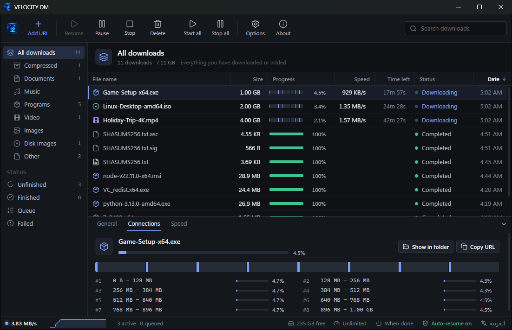
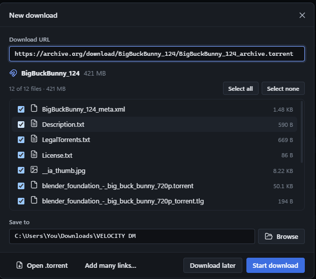
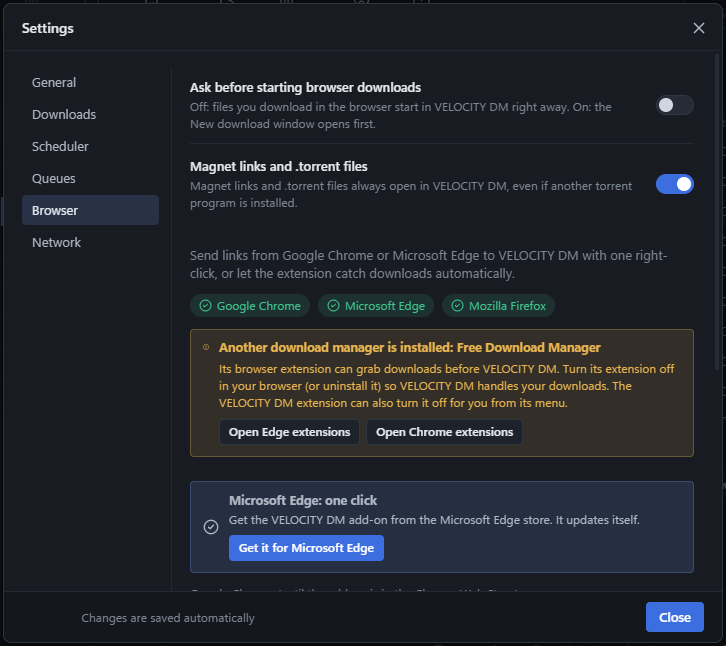

<div align="center">


# VELOCITY DM

**A fast, free download manager for Windows 10 and 11.**<br />
Up to 32 connections per file · resumes after crashes and restarts · torrents · videos from websites · English and العربية

[](https://github.com/cloudd128/velocity-dm/releases/latest)


### [⬇&nbsp; Download for Windows](https://velocity-dm.pages.dev/download?from=github)

[Website](https://velocity-dm.pages.dev/) · [Release notes](https://velocity-dm.pages.dev/releases) · [Edge add-on](https://microsoftedge.microsoft.com/addons/detail/gppmegmppnclmoagmcjlpieeefmeldnj) · [Privacy](https://velocity-dm.pages.dev/privacy) · [Report a problem](https://velocity-dm.pages.dev/report) · [العربية ↓](#بالعربي)

<br />



</div>

## Why VELOCITY DM

| | |
|---|---|
| ⚡ **Fast** | Splits each file across up to 32 connections and adds them only while they make it faster. Learns each server’s limit so it is never blocked. |
| 🔁 **Never starts over** | Progress is saved every two seconds. Downloads continue after a dropped connection, a crash, a power cut or a Windows restart. |
| ✅ **Correct files** | Sizes and server fingerprints checked on every response, optional SHA-256, and a file you already have is never overwritten. |
| 🌐 **Catches browser downloads** | Add-on for Microsoft Edge, Chrome and Firefox: downloads go straight to VELOCITY DM, which opens by itself if it was closed. |
| 🧲 **Torrents** | Magnet links and `.torrent` files, pick only the files you want, share finished torrents with friends. No ads. |
| 🎬 **Videos from websites** | The add-on lists the videos a page plays, including streaming video (`.m3u8`), saved as MP4. Preview while downloading, convert to MP4 / MKV / MP3 / M4A. |
| 🗓️ **In control** | Queues, a night scheduler, global and per-download speed limits, daily / monthly data limits, shut down when done. |
| 🔒 **Private** | No account, no ads, no tracking. Proxy support (HTTP / SOCKS5) and site logins stored encrypted. |
| 🔄 **Updates itself** | Signed updates install quietly when nothing is downloading. |

## Screenshots

<table>
  <tr>
    <td width="50%"><br /><sub>Open a torrent and pick the files you want</sub></td>
    <td width="50%"><br /><sub>Browser integration, magnet links and .torrent files</sub></td>
  </tr>
</table>

## Install

1. **[Download the installer](https://velocity-dm.pages.dev/download?from=github)** (about 7 MB) and run it. It installs for your user only — no administrator rights needed.
2. Get the browser add-on: **[Microsoft Edge](https://microsoftedge.microsoft.com/addons/detail/gppmegmppnclmoagmcjlpieeefmeldnj)**, or for Chrome open VELOCITY DM → *Options* → *Browser*.

Or with **winget** (once Microsoft has reviewed the package):

```powershell
winget install VelocityDM.VelocityDM
```

> **“Windows protected your PC”?** Windows shows this for apps it has not seen many times yet. Click **More info → Run anyway**. Every release lists [SHA-256 checksums](https://velocity-dm.pages.dev/releases) so you can check the file.

**Requirements:** Windows 10 or 11, 64-bit. WebView2 (built into Windows 11, installed automatically if missing).

## Guides

- [A free alternative to Internet Download Manager](https://velocity-dm.pages.dev/idm-alternative)
- [Free torrent downloader for Windows, without ads](https://velocity-dm.pages.dev/torrent-downloader)
- [Download videos from websites](https://velocity-dm.pages.dev/video-downloader)
- [How to resume a failed download in Chrome or Edge](https://velocity-dm.pages.dev/resume-failed-downloads)

---

<div dir="rtl" align="right">

## بالعربي

**VELOCITY DM** برنامج تحميل **مجاني** لويندوز 10 و11 — من غير إعلانات ولا فترة تجربة ولا حساب.

- ⚡ **أسرع:** بيقسّم الملف على لحد 32 اتصال، وبيزوّدهم بس لو بيسرّعوا فعلًا.
- 🔁 **عمره ما يبدأ من الأول:** بيكمّل بعد قطع النت أو الكهربا أو ريستارت ويندوز.
- 🌐 **بيلقط تحميلات المتصفح:** إضافة لإيدج وكروم وفايرفوكس، والبرنامج بيفتح لوحده لو كان مقفول.
- 🧲 **تورنت:** روابط Magnet وملفات ‎.torrent‎، واختار الملفات اللي عايزها بس.
- 🎬 **فيديوهات المواقع:** حتى البث، وبيتحفظ MP4، وتقدر تتفرج عليه وهو بيتحمّل.
- 🗓️ **تحكم كامل:** طوابير، وجدولة بالليل، وحدود للسرعة والباقة، وإطفاء الجهاز لما يخلص.
- 🔤 **واجهة عربي كاملة** من اليمين للشمال.

### [⬇ حمّل البرنامج](https://velocity-dm.pages.dev/download?from=github-ar) · [الموقع بالعربي](https://velocity-dm.pages.dev/ar/) · [بديل IDM مجاني](https://velocity-dm.pages.dev/ar/idm-alternative)

</div>

---

<sub>VELOCITY DM is free software for personal and commercial use; it is not open source. Internet Download Manager and IDM are trademarks of their owner and are mentioned only for comparison.</sub>
