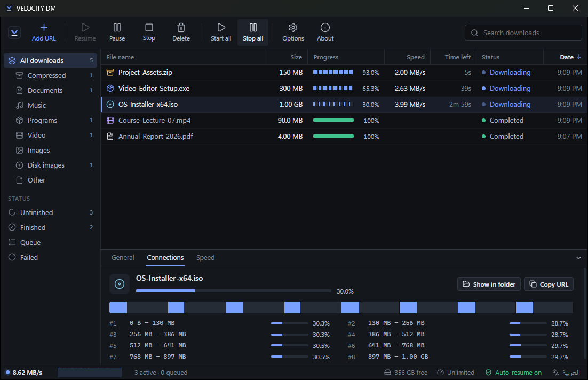

# VELOCITY DM

A fast, compact download manager for Windows 10 and 11 — free.

**[Download the latest version](https://github.com/cloudd128/velocity-dm/releases/latest/download/VELOCITY-DM-Setup-x64.exe)** ·
[Website](https://cloudd128.github.io/velocity-dm/) ·
[All releases](https://github.com/cloudd128/velocity-dm/releases) ·
[Privacy policy](https://cloudd128.github.io/velocity-dm/privacy.html)

- Multi-connection downloads (up to 32) with a live connection map
- Pause/resume, and automatic resume after crashes and Windows restarts
- Integrity checks on every response, optional SHA-256, never overwrites existing files
- Scheduler for night / off-peak internet plans
- Chrome and Edge extension
- English and Arabic

The app updates itself from this page. Checksums for every file are in `SHA256SUMS.txt`
on each release.

**Support:** open an [issue](https://github.com/cloudd128/velocity-dm/issues).

This repository hosts the website and the official downloads. VELOCITY DM is proprietary
software; the source code is not public.
